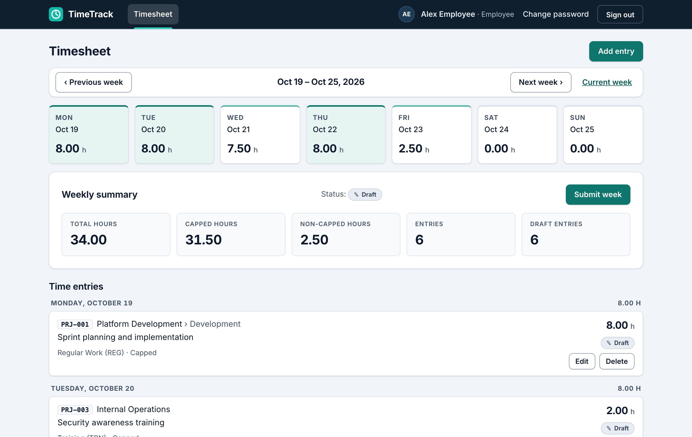
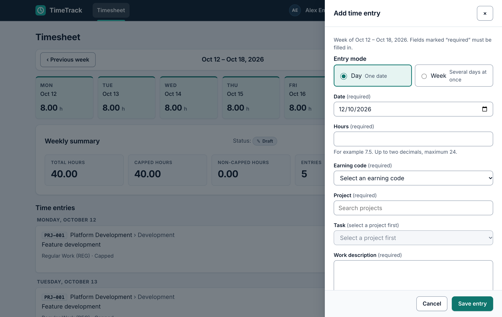
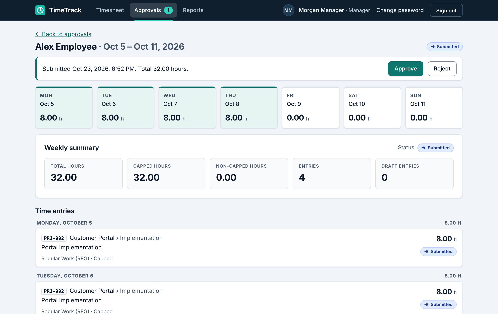
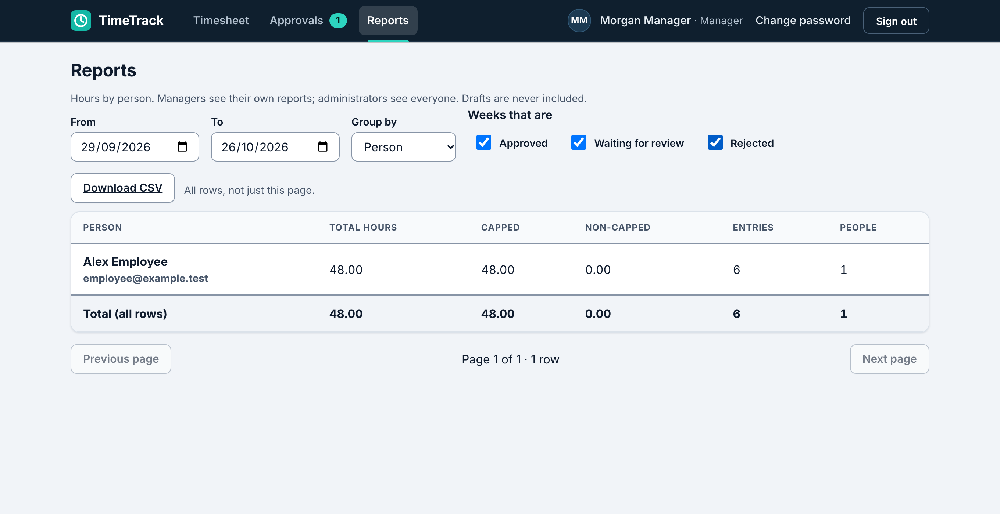

<h1 align="center">TimeTrack</h1>

<p align="center">
  Weekly timesheets with a real approval trail — enter hours, submit the week, get it approved or sent back.
</p>

<p align="center">
  <a href="https://timetrack-demo-kanak.vercel.app"><b>Live demo</b></a> ·
  <a href="docs/user-guide.md">User guide</a> ·
  <a href="docs/architecture.md">Architecture</a> ·
  <a href="CHANGELOG.md">Release notes</a> ·
  <a href="docs/development.md">Run it locally</a>
</p>

<p align="center">
  <a href="https://github.com/kanakverma89/timetrack/actions/workflows/ci.yml"></a>
  <a href="https://github.com/kanakverma89/timetrack/actions/workflows/audit.yml"></a>
</p>

<p align="center">
  <a href="https://timetrack-demo-kanak.vercel.app"></a>
</p>

---

## About

TimeTrack is a weekly timesheet application. Employees record hours against projects and tasks, submit the
week, and a manager approves it or sends it back with a reason. Administrators manage people, teams, projects,
earning codes and the hour policy, and can read an audit log. Managers and administrators export reports to CSV.

It is a modular monolith — one React app, one FastAPI service, one PostgreSQL database — built to be easy to
run, easy to reason about, and tested end to end. Every demo account and every row of data is synthetic.

## Why it exists

Timesheets usually go wrong in the same few places. TimeTrack is designed around them:

| Problem | How TimeTrack handles it |
| --- | --- |
| Hours live in spreadsheets and chat messages, so nobody trusts the totals | One place to enter time, in **Day mode** (one day at a time) or **Week mode** (the whole grid), with limits checked before a week can be submitted |
| Nobody knows whether a week is final | A week has one clear state — draft, submitted, approved or rejected — shown in the diagram below |
| Approvals happen in email and leave no record | Managers approve or reject in the app; a rejection needs a written reason, and decisions are recorded |
| Employees can't take back a mistaken submission | **Withdraw** a submitted week yourself, as long as no manager has decided |
| Who can see or change what is unclear | Role-based access (employee, manager, admin), enforced on the server and covered by tests |
| Policy changes are untraceable | Admin changes to the hour policy and catalogue are written to an audit log that holds no personal data |

## Who it's for

- **Small and mid-size teams and agencies** that bill or report by the hour and want a lightweight, self-hosted
  alternative to a heavyweight HR suite.
- **Employees** who want to log hours in seconds, **managers** who need a clear queue of weeks to review, and
  **administrators** who own the rules.
- **Engineers and QA** looking for a worked example of a full-stack app with a layered backend, a real
  browser test suite and a CI/CD pipeline.

## What you can do

| Role | Capabilities |
| --- | --- |
| **Employee** | Weekly dashboard · add, edit and delete hours in Day or Week mode · submit a week · withdraw a submission · fix and resubmit a rejected week · change password |
| **Manager** | Approvals queue for the people they manage · approve or reject with a reason · **Reports** with CSV export |
| **Administrator** | Create and manage users and teams · projects and tasks · earning codes · hour policy · audit log |

A walkthrough of every role and scenario is in the [user guide](docs/user-guide.md).

### A quick tour

**Enter time** in Day mode (one date) or Week mode (several days at once). The form checks hours, earning code, project and task before it saves:



**Review a week** as a manager: the days, the weekly summary and every entry are on one screen, with Approve and Reject at the top:



**Report on hours** by person, project, earning code or week, and download everything as CSV:



### The life of a timesheet week

<picture>
  <source media="(prefers-color-scheme: dark)" srcset="docs/images/lifecycle-dark.svg">
  
</picture>

## Try it

**https://timetrack-demo-kanak.vercel.app** — a free-tier deployment (Vercel frontend, Render API, Neon PostgreSQL).
All data is synthetic.

| Role | Email | Name | What to try |
| --- | --- | --- | --- |
| Employee | `employee@example.test` | Alex Employee | add hours (Day and Week mode), submit a week, see a rejection and resubmit |
| Manager | `manager@example.test` | Morgan Manager | **Approvals**: review, approve or reject Alex's and Sam's weeks; **Reports** with CSV export |

**Password for both:** `Quartz-Kettle-Maple-8201`

- **The first visit after a quiet spell can take about a minute.** The free API host puts the service to sleep after
  15 minutes without traffic; later requests are fast.
- It is a shared demo: anyone with these logins can add and submit entries, so what you see may not be what you left.
- The administrator account is not published. How the demo is set up, its limits and how to reset it:
  [`docs/deployment-free-tier.md`](docs/deployment-free-tier.md).

## How it's built

<picture>
  <source media="(prefers-color-scheme: dark)" srcset="docs/images/architecture-dark.svg">
  
</picture>

| Layer | Choice |
| --- | --- |
| Frontend | React 19, TypeScript, Vite, TanStack Query |
| Backend | FastAPI, SQLAlchemy 2, Pydantic 2, Alembic migrations |
| Database | PostgreSQL 16 |
| Tests | pytest · Vitest · Playwright |
| Delivery | Docker, GitHub Actions, Vercel + Render + Neon (demo) |

The backend is layered — **routers → services → repositories → models** — so business rules live in one place and
can be unit-tested without a database. Details and the reasons behind each choice:
[`docs/architecture.md`](docs/architecture.md) and [`docs/decisions.md`](docs/decisions.md).

<details>
<summary><b>Database schema</b></summary>

<picture>
  <source media="(prefers-color-scheme: dark)" srcset="docs/images/erd-dark.svg">
  
</picture>

Composite foreign keys make the database itself reject a time entry whose employee differs from its week's owner,
or whose task does not belong to its project. Full reference: [`docs/data-model.md`](docs/data-model.md).

</details>

The interactive versions of these diagrams (hover, trace a route, export) are in
[`docs/system-views/`](docs/system-views/) — download and open the `.html` files in a browser.

## Security

- Local email and password sign-in; passwords hashed with **Argon2id**.
- Sessions are random 256-bit tokens in an `HttpOnly`, `SameSite=Lax` cookie (`Secure` in production). Only a keyed
  digest is stored, and nothing is kept in `localStorage`.
- **CSRF** guard on every state-changing request, a strict CORS allow-list, security headers, and login
  **rate limiting**.
- Authorization is deny-by-default, and the employee identity always comes from the session. A test walks the
  whole route matrix per role.
- Audit data is free of personal details and is protected by database triggers.

Known limits, stated plainly: no SSO or MFA, no TLS termination of its own, no email delivery, no approval
delegation. See [`docs/security-review.md`](docs/security-review.md) and [`docs/operations.md`](docs/operations.md).

## Quality

| Level | What | Where |
| --- | --- | --- |
| Unit | Backend: week math, summaries, security helpers, rules. Frontend: components, forms, API client | `backend/app/tests/`, `frontend/src/` |
| Integration | Backend API tests against a real PostgreSQL database, plus migration, seed and database-integrity checks | `backend/app/tests/` |
| End to end | Playwright journeys for all three roles in Chromium, Firefox and WebKit, run against a freshly seeded database | `frontend/tests/e2e/` |
| Smoke | A small Playwright suite run against the **deployed** demo (`deploy-verify` workflow) | `frontend/tests/smoke/` |
| Non-functional | Lint, formatting and types (ruff, mypy, ESLint, tsc), dependency audit, a performance check, a backup and restore drill | [`docs/testing-strategy.md`](docs/testing-strategy.md) |

At the Phase 7 sign-off the suites held **540 backend tests, 254 frontend tests and 369 Playwright tests** (362 passed,
7 skipped); see [`docs/implementation-report.md`](docs/implementation-report.md). Later work added more.

Every push runs the **CI** workflow: backend lint, types, migrations and tests; frontend lint, types, unit tests
and build; then the full Playwright suite. On the performance check, the dashboard read has a p95 of about 6 ms and
an entry save about 11 ms, against a 500 ms target ([`docs/performance.md`](docs/performance.md)). The
E2E test cases are catalogued in [`docs/e2e-test-cases.xlsx`](docs/e2e-test-cases.xlsx), with a guide to the approach
in [`docs/playwright-architect-study-guide.md`](docs/playwright-architect-study-guide.md).

## Deploying

- **Production-style, on your own host:** [`compose.prod.yaml`](compose.prod.yaml) runs the database, one-shot
  migrations, the API and an nginx front end as containers. Configuration, first administrator, backups, restore and
  retention: [`docs/operations.md`](docs/operations.md).
- **Free-tier demo:** Vercel (frontend), Render (API), Neon (PostgreSQL), set up by following
  [`docs/deployment-free-tier.md`](docs/deployment-free-tier.md).

## Run it locally

Needs Docker, Python 3.12+ and Node 22.22+. The short version:

```bash
cp .env.example .env            # replace every placeholder
scripts/dev-up.sh               # database, migrations, API and web app
```

Full setup, seeded accounts, every check command and troubleshooting: [`docs/development.md`](docs/development.md).

## Documentation

| Start here | |
| --- | --- |
| [`docs/user-guide.md`](docs/user-guide.md) | How to use the app, role by role |
| [`spec.md`](spec.md) | The product and technical specification |
| [`docs/architecture.md`](docs/architecture.md) · [`docs/data-model.md`](docs/data-model.md) · [`docs/api-contracts.md`](docs/api-contracts.md) | How it is built |
| [`docs/decisions.md`](docs/decisions.md) | Why it is built that way |
| [`docs/implementation-report.md`](docs/implementation-report.md) | What is built and what was verified, including known limitations |
| [`CHANGELOG.md`](CHANGELOG.md) | Release notes |

**Status:** Phases 0–7 complete (foundation, Employee Dashboard, Day and Week mode, weekly submission, manager
approvals, administration, reporting and hardening), plus withdrawing a submission and the enterprise UI refresh.
